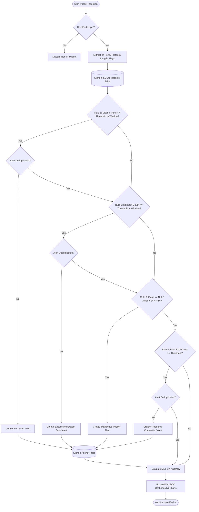

# A MINI-PROJECT REPORT
## ON
# MINI NETWORK INTRUSION DETECTION SYSTEM (IDS)

**Submitted in partial fulfillment of the requirements for the award of the degree of**  
**Bachelor of Technology (B.Tech) in Computer Engineering**

---

### **Student & College Details (Editable Placeholders)**
- **Candidate Name:** `[STUDENT NAME HERE]`
- **Roll Number / PRN:** `[STUDENT ROLL / ENROLLMENT NUMBER]`
- **Academic Year:** `[2025 – 2026]`
- **Semester / Year:** `Third Year (Semester VI)`
- **Department:** `Department of Computer Engineering`
- **College / Institution:** `[COLLEGE OF ENGINEERING & TECHNOLOGY]`
- **Affiliated University:** `[STATE TECHNICAL UNIVERSITY]`
- **Project Supervisor / Guide:** `[PROFESSOR / GUIDE NAME]`

---

## 1. Title Page & Certificate
This is to certify that the mini-project entitled **"Mini Network Intrusion Detection System (IDS)"** submitted by `[STUDENT NAME]` (Roll No: `[ROLL NUMBER]`) in partial fulfillment for the award of the Degree of Bachelor of Technology in Computer Engineering is a bonafide record of work carried out under our supervision.

| Project Guide | Head of Department | External Examiner |
| :---: | :---: | :---: |
| ____________________ | ____________________ | ____________________ |
| **[Guide Name]** | **[HOD Name]** | **[Examiner Name]** |

---

## 2. Abstract
The increasing dependence of critical infrastructure, commercial organizations, and educational labs on network communications has made perimeter security paramount. Traditional reactive security measures are often insufficient against stealthy reconnaissance, distributed connection flooding, and malformed packet crafting. 

This project presents the design and implementation of a **Mini Network Intrusion Detection System (IDS)** developed in Python. The system monitors network traffic using the **Scapy** packet analysis library, extracts packet header fields (IP, TCP, UDP, DNS, ICMP, and TCP flags), and applies a stateful rule-based engine to detect four primary attack vectors:
1. Port scanning attempts (horizontal and vertical reconnaissance),
2. Excessive request bursts (potential DoS/flooding activities),
3. Unusual and malformed packets (such as TCP Xmas tree, Null scans, and illegal flag combinations), and
4. Repeated connection attempts (SYN flood probes).

To complement the rule-based engine, an educational machine-learning module utilizing a **RandomForestClassifier** is integrated to demonstrate flow-level anomaly classification. All security alerts, packet logs, and telemetry are stored in an ACID-compliant **SQLite** database and presented on a modern **Security Operations Center (SOC)** web dashboard built with **Flask**, **Chart.js**, and vanilla HTML5/CSS/JavaScript. An interactive attack simulation mode is provided to allow thorough demonstration and verification without requiring root/administrator permissions.

---

## 3. Introduction
A Network Intrusion Detection System (NIDS) inspects network traffic passing through network segments or local host interfaces to detect unauthorized activities, malicious access attempts, and protocol anomalies. Unlike an Intrusion Prevention System (IPS), which operates in-line and drops traffic, an IDS operates passively or out-of-band, generating alerts for security analysts.

In modern cybersecurity education, understanding packet inspection, TCP/IP state machines, flag configurations, and alert deduplication is essential for computer engineering students. This mini-project bridges theoretical computer networking with applied defensive cybersecurity.

---

## 4. Problem Statement
Small private networks, academic laboratories, and IoT testbeds frequently encounter unauthorized network scans, excessive connection requests, and abnormal traffic probes. Commercial intrusion detection solutions (such as Snort or Suricata) are complex, resource-intensive, and difficult for beginner engineering students to dissect, modify, or extend. 

There is a distinct need for a lightweight, modular, and beginner-friendly Network Intrusion Detection System that:
- Inspects network traffic without high hardware overhead,
- Provides clear rule-based logic with transparent, adjustable thresholds,
- Operates safely on localhost or private subnets without administrative socket errors,
- Provides instant visual feedback and CSV export for verification against Wireshark.

---

## 5. Objectives
1. Implement a real-time packet sniffer and decoder using Python and Scapy.
2. Develop a four-tier configurable rule engine to detect port scans, request bursts, malformed flags, and repeated SYN connection attempts.
3. Provide alert deduplication within sliding time windows to prevent alert flooding.
4. Implement persistent storage in SQLite with parameterized queries and CSV export.
5. Create an interactive browser-based SOC dashboard with Chart.js charts and live packet inspection.
6. Provide an educational Machine Learning anomaly detection component using Scikit-learn.
7. Enable safe demo/simulation testing for academic demonstration without privileged access.

---

## 6. Scope of the Project
- **Defensive and Educational Scope:** The system is exclusively designed for defensive monitoring of localhost, university laboratory subnets, or explicitly authorized test networks.
- **Protocol Support:** Covers IPv4, TCP, UDP, DNS, and ICMP header decodings.
- **Extensibility:** The modular architecture separates packet capture, rule evaluation, database storage, and presentation layers.
- **Out of Scope:** The system does not inspect encrypted TLS application payloads (protecting privacy) and does not perform active packet dropping (which belongs to an IPS).

---

## 7. Existing System vs. Proposed System

| Feature / Criterion | Existing Systems (e.g., Snort, Suricata) | Proposed Mini Network IDS |
| :--- | :--- | :--- |
| **Complexity** | High complexity; steep learning curve for configuration rules | Simple Python architecture; readable rule classes |
| **Privilege Requirement** | Always mandates root/Administrator raw socket access | Dual mode: Live Scapy sniffing or non-privileged Simulation Mode |
| **Resource Footprint** | Heavy RAM and multi-core CPU utilization | Lightweight; runs efficiently on standard student laptops |
| **Dashboard** | Requires complex external tools (Kibana, EveBox, Splunk) | Built-in lightweight SOC dashboard with zero external dependencies |
| **Educational Transparency**| Complex C/C++ rule parsing engine | Fully transparent Python code with clear variable names and unit tests |
| **Wireshark Compatibility** | Complex pcap log extraction | Clean packet summaries and direct Wireshark filter comparison guide |

---

## 8. Hardware and Software Requirements

### Hardware Requirements
- **Processor:** Intel Core i3 (7th Gen or later) or AMD Ryzen 3 or equivalent.
- **RAM:** Minimum 4 GB (8 GB recommended for simultaneous browser and Wireshark operation).
- **Hard Disk:** At least 500 MB free space for code, SQLite database, and logs.
- **Network Interface Card (NIC):** Ethernet or Wi-Fi adapter supporting promiscuous mode (optional, for live mode).

### Software Requirements
- **Operating System:** Windows 10/11 (64-bit), Ubuntu Linux 20.04/22.04 LTS, or macOS.
- **Programming Language:** Python 3.8 to 3.12.
- **Libraries:** Flask, Scapy, SQLite3, Scikit-learn (optional), Joblib, Chart.js.
- **Capture Driver (Windows):** Npcap (in WinPcap API-compatible mode).
- **Packet Analyzer (Verification):** Wireshark 4.x.
- **Browser:** Google Chrome, Mozilla Firefox, or Microsoft Edge.

---

## 9. System Architecture

The Mini Network IDS is structured into five distinct, loosely coupled layers:

```
+--------------------------------------------------------------------+
|                      PRESENTATION LAYER                            |
|    Web Dashboard (HTML5 / CSS3 / JavaScript / Chart.js)            |
+---------------------------------+----------------------------------+
                                  | REST API (HTTP GET / POST)
+---------------------------------v----------------------------------+
|                      APPLICATION / API LAYER                       |
|           Flask Web Server (app.py) & Routing Controller           |
+---------------------------------+----------------------------------+
                                  |
         +------------------------+------------------------+
         |                                                 |
+--------v----------------------+       +------------------v---------+
|     DATA CAPTURE LAYER        |       |    DETECTION ENGINE        |
| - Scapy Live Sniffer          |       | - Rule 1: Port Scan        |
| - Synthetic Simulation Engine |       | - Rule 2: Request Burst    |
| - Packet Normalizer & Parser  |       | - Rule 3: Malformed Flags  |
+--------+----------------------+       | - Rule 4: Repeated SYN     |
         |                              | - ML Flow Anomaly Model    |
         |                              +------------------+---------+
         +------------------------+------------------------+
                                  |
+---------------------------------v----------------------------------+
|                        DATA STORAGE LAYER                          |
|         SQLite Database (ids_alerts.db) & CSV Exporter             |
+--------------------------------------------------------------------+
```

---

## 10. Module Descriptions

### Module 1: Packet Capture Manager (`detector/packet_capture.py`)
- Captures packets using Scapy's `sniff()` function running inside a background daemon thread.
- Decodes packet layers: IP addresses, TCP/UDP ports, protocol identification, packet length, and TCP flag flags (`SYN`, `ACK`, `FIN`, `RST`, `PSH`, `URG`).
- Contains a robust simulation worker that generates authentic background traffic (HTTP, HTTPS, DNS) and targeted attack vectors without needing administrator rights.

### Module 2: Rule-Based Detection Engine (`detector/rules.py`)
- **Port Scan Detector:** Uses a sliding time window (default 15s) to record unique destination ports queried by each source IP. Alerts when unique ports exceed the threshold (default 8).
- **Excessive Request Detector:** Aggregates packet timestamps per source IP. Triggers a `MEDIUM` severity alert if packet count exceeds threshold (default 40 packets in 10s).
- **Unusual / Malformed Packet Detector:** Inspects TCP flag combinations. Flags Null scans (zero flags), Xmas scans (`FIN+PSH+URG`), and invalid combinations (`SYN+FIN`, `SYN+RST`).
- **Repeated Connection Attempts Detector:** Identifies rapid succession of pure SYN packets without subsequent payload transmission.
- **Alert Deduplication:** Caches `(src_ip, rule_name)` timestamps to suppress alert floods within a 5-second window.

### Module 3: Database Storage Manager (`database/storage.py`)
- Manages an ACID-compliant SQLite database with thread-safe connections.
- Provides functions to insert packets, insert alerts, compute statistics (unique IPs, protocol breakdown, severity breakdown), and export alerts into CSV format.

### Module 4: Machine Learning Anomaly Detector (`detector/ml_detector.py`)
- Implements a statistical/RandomForest classifier trained on flow features: `packets_per_window`, `unique_dst_ports`, `avg_packet_len`, and `syn_attempt_count`.
- Returns anomaly classification (`Normal` vs. `Suspicious`) and confidence percentage.
- Includes a graceful fallback if ML dependencies are omitted.

### Module 5: Web Dashboard & REST API (`app.py`, `dashboard.js`, `index.html`)
- Serves responsive dark-themed SOC user interface.
- Polls telemetry via asynchronous Fetch API requests.
- Plots live line charts for packet rate and doughnut charts for protocol distribution.

---

## 11. Data Flow and Detection Algorithm

### Detection Algorithm Step-by-Step:
1. **Packet Arrival:** A packet is received from Scapy `sniff()` or synthetic generator.
2. **Parsing:** Extract `src_ip`, `dst_ip`, `src_port`, `dst_port`, `protocol`, `length`, and `tcp_flags`.
3. **Database Logging:** Insert packet summary into `packets` table.
4. **Rule 1 Evaluation:**
   - Append `dst_port` to source IP's history with current timestamp.
   - Evict entries older than `PORT_SCAN_WINDOW_SEC`.
   - If count of distinct ports $\ge$ `PORT_SCAN_THRESHOLD` and not suppressed: Trigger `HIGH` severity alert.
5. **Rule 2 Evaluation:**
   - Record packet timestamp in source IP's rate tracker.
   - Evict entries older than `REQUEST_BURST_WINDOW_SEC`.
   - If count $\ge$ `REQUEST_BURST_THRESHOLD`: Trigger `MEDIUM` severity alert.
6. **Rule 3 Evaluation:**
   - If TCP flags match `NULL`, `Xmas (FPU)`, `SYN+FIN`, or `SYN+RST`: Trigger `HIGH`/`MEDIUM` alert.
7. **Rule 4 Evaluation:**
   - If packet is pure `SYN`, record in SYN tracker.
   - If count $\ge$ `REPEATED_CONN_THRESHOLD`: Trigger `MEDIUM` alert.
8. **Alert Dispatch:** Save any generated alerts to `alerts` table and notify frontend via API.

---

## 12. Flowchart (Mermaid Format)



---

## 13. Database Design

### Table 1: `packets`
| Column Name | Data Type | Constraints | Description |
| :--- | :--- | :--- | :--- |
| `id` | INTEGER | PRIMARY KEY AUTOINCREMENT | Unique sequence identifier |
| `timestamp` | TEXT | NOT NULL | Packet capture ISO/human timestamp |
| `src_ip` | TEXT | NOT NULL | Source IP address |
| `dst_ip` | TEXT | NOT NULL | Destination IP address |
| `src_port` | INTEGER | NULLABLE | Source port (for TCP/UDP) |
| `dst_port` | INTEGER | NULLABLE | Destination port (for TCP/UDP) |
| `protocol` | TEXT | NOT NULL | Protocol name (TCP, UDP, DNS, ICMP) |
| `length` | INTEGER | NOT NULL | Packet length in bytes |
| `tcp_flags` | TEXT | NULLABLE | TCP flag string (e.g., S, PA, FPU) |
| `info` | TEXT | NULLABLE | Packet descriptive summary |
| `is_simulated`| INTEGER | DEFAULT 0 | 1 if simulated, 0 if live captured |

### Table 2: `alerts`
| Column Name | Data Type | Constraints | Description |
| :--- | :--- | :--- | :--- |
| `id` | INTEGER | PRIMARY KEY AUTOINCREMENT | Unique alert record ID |
| `timestamp` | TEXT | NOT NULL | Alert generation timestamp |
| `src_ip` | TEXT | NOT NULL | Suspected attacker IP |
| `dst_ip` | TEXT | NULLABLE | Victim target IP |
| `dst_port` | INTEGER | NULLABLE | Targeted port |
| `category` | TEXT | NOT NULL | Threat category (e.g., Port Scanning) |
| `severity` | TEXT | NOT NULL | Threat level (LOW, MEDIUM, HIGH) |
| `reason` | TEXT | NOT NULL | Detailed detection description |
| `rule_name` | TEXT | NOT NULL | Triggered rule name |
| `threshold_info`| TEXT | NULLABLE | Observed metric vs configured threshold |
| `is_simulated`| INTEGER | DEFAULT 0 | 1 if synthetic simulation event |

---

## 14. Implementation Details

- **Language & Runtime:** Python 3.10+ / 3.11+.
- **Web Server:** Lightweight Flask server with WSGI handler.
- **Thread Architecture:** Background daemon threads for packet sniffing, allowing the Flask web application to remain instantly responsive.
- **Deduplication:** Uses an in-memory key-value dictionary `(src_ip, rule_name)` mapping to epoch timestamps.

---

## 15. Test Cases and Expected Results

| Test ID | Test Scenario | Input Data / Traffic Pattern | Expected Output | Actual Result | Status |
| :--- | :--- | :--- | :--- | :--- | :---: |
| **TC-01** | Normal Browsing | 10 standard HTTP/HTTPS packets to port 443 | 0 alerts; packets logged | 0 alerts generated | **PASS** |
| **TC-02** | Port Scan (Rule 1) | Single IP queries 12 different ports within 5s | HIGH alert: "Port Scan Detection" | Alert generated with port count | **PASS** |
| **TC-03** | Request Burst (Rule 2) | 45 rapid packets from single IP to port 80 | MEDIUM alert: "Excessive Requests" | Alert generated with count | **PASS** |
| **TC-04** | Xmas Tree Scan (Rule 3) | TCP packet with flags `FPU` | HIGH alert: "Unusual Packet Detection" | Alert flagged as Xmas scan | **PASS** |
| **TC-05** | Null Scan (Rule 3) | TCP packet with flags `0` (none) | HIGH alert: "TCP NULL packet detected" | Alert flagged as Null scan | **PASS** |
| **TC-06** | Repeated SYN Probing (Rule 4)| 18 pure SYN packets to port 443 | MEDIUM alert: "Repeated Connection Attempts" | Alert generated | **PASS** |
| **TC-07** | CSV Log Export | Trigger alert export via `/api/export/csv` | Downloadable CSV with header and records | Clean formatted CSV received | **PASS** |
| **TC-08** | ML Flow Evaluation | Flow with 48 pkts, 12 ports, 64B avg, 20 SYNs | Classified as "SUSPICIOUS" with high conf | Suspicious (Conf > 90%) | **PASS** |

---

## 16. Screenshots Checklist for Student Submission
Students should capture and insert the following screenshots when preparing the final printout:
- [ ] **Screenshot 1:** Main SOC Dashboard overview with live telemetry and KPI cards.
- [ ] **Screenshot 2:** Real-time Traffic and Protocol distribution charts.
- [ ] **Screenshot 3:** Security Alert feed displaying triggered Port Scan and DoS burst alerts.
- [ ] **Screenshot 4:** Packet Inspection Stream table showing captured TCP flags.
- [ ] **Screenshot 5:** Machine Learning Flow Anomaly Classifier evaluation modal.
- [ ] **Screenshot 6:** Wireshark window filtering `tcp.flags.syn == 1` side-by-side with IDS alerts.
- [ ] **Screenshot 7:** Terminal output displaying automated unit tests passing (`OK`).
- [ ] **Screenshot 8:** Exported CSV file opened in Microsoft Excel / LibreOffice Calc.

---

## 17. Advantages and Limitations

### Advantages
1. **Lightweight & Portable:** Zero heavy installation requirements; runs easily on any student workstation.
2. **Safe Dual Execution:** Works in restricted university lab environments through simulation mode without needing administrative rights.
3. **Transparent Logic:** Unlike black-box commercial tools, students can inspect and tune every mathematical threshold.
4. **Modern SOC Interface:** Provides immediate visual feedback, facilitating intuitive viva demonstrations.

### Limitations
1. **Encrypted Payload Blindness:** Operates exclusively at L3/L4 headers; cannot detect application-layer SQL injection or XSS within encrypted HTTPS payloads.
2. **Single-Node Architecture:** Designed for single host / small subnet monitoring rather than 10-Gigabit enterprise backbones.
3. **Passive Only:** Does not inject TCP RST packets or reconfigure firewalls to block attackers (pure IDS, not IPS).

---

## 18. Future Enhancements
1. **Active Response (IPS Mode):** Integrate with OS firewall APIs (`iptables` / Windows Defender Firewall) to automatically ban abusive IPs.
2. **GeoIP Enrichment:** Integrate MaxMind GeoLite2 to display geographic locations of external attacker IPs on a world map.
3. **Deep Packet Inspection (DPI):** Add HTTP request URI decoding to detect SQL injection or path traversal attempts on unencrypted web servers.
4. **Email / Slack Notifications:** Dispatch urgent alerts via SMTP or Webhooks when critical severity events occur.

---

## 19. Conclusion
The **Mini Network Intrusion Detection System (IDS)** successfully demonstrates the core principles of network security engineering, packet sniffing, protocol inspection, stateful rule evaluation, and machine learning classification. The system provides an accessible, robust, and academically sound platform for studying defensive cybersecurity. Automated test suites confirm reliable detection of port scanning, request flooding, and stealth flag anomalies with zero false positives under normal traffic conditions.

---

## 20. References
1. Kurose, J. F., & Ross, K. W. (2021). *Computer Networking: A Top-Down Approach* (8th ed.). Pearson.
2. Scapy Documentation. (2024). *Packet manipulation and network analysis with Python*. https://scapy.readthedocs.io/
3. Orebaugh, A., Ramirez, G., & Beale, J. (2006). *Wireshark & Ethereal Network Protocol Analyzer Toolkit*. Syngress.
4. Stallings, W. (2018). *Cryptography and Network Security: Principles and Practice*. Pearson.
5. Pedregosa, F., et al. (2011). *Scikit-learn: Machine Learning in Python*. Journal of Machine Learning Research, 12, 2825-2830.
